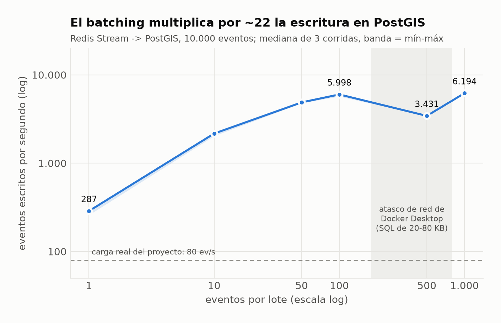
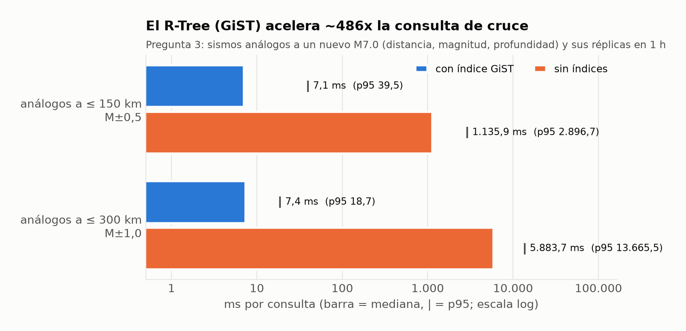
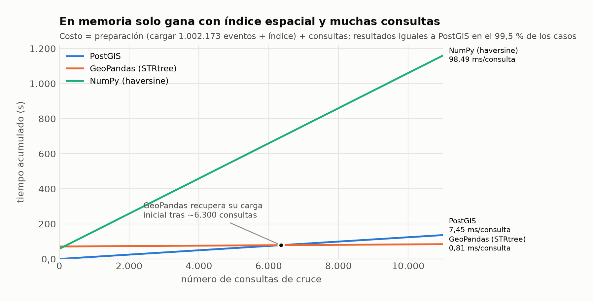
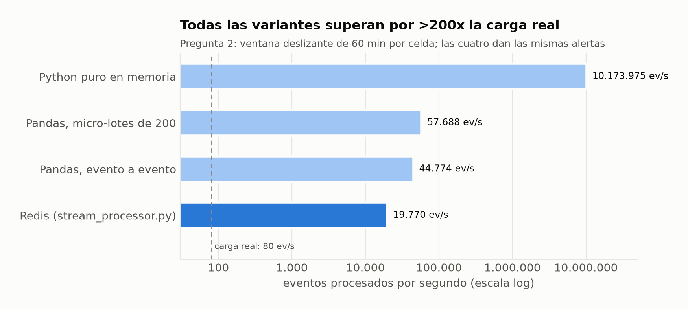

# Proyecto: sismos en tiempo real + histórico (Redis + PostGIS + NiFi)

Curso Procesamiento Masivo de Datos, USM 2026-2.

```
                     ┌─────────────────────── NiFi (opcional, Paso 7) ───────────────────────┐
simulador ──HTTP──►  │ ListenHTTP ─► ValidateRecord ─┬─► ExecuteGroovyScript (XADD) ──────────┼─► Redis Stream sismos:in
   │                 │                               └─► MergeRecord ─► PutDatabaseRecord ────┼─► PostGIS
   │                 └────────────────────────────────────────────────────────────────────────┘
   └──XADD directo──► Redis Stream (sismos:in) ──┬─► stream_processor.py ──► Pub/Sub: alerts:swarm / alerts:mainshock
                                                 └─► pg_batch_writer.py  ──► PostGIS (lotes de 500; sin NiFi)
                                                                                  ▲
alerts:mainshock ──► cross_query.py ──── análogos (ST_DWithin) + sus réplicas ───┘
```

Hay dos modos de ingesta: **directo** (`--sink redis` + `pg_batch_writer.py`, Pasos 5-6) o **con NiFi**
(`--sink http`, Paso 7), donde NiFi valida y reparte a Redis y PostGIS. El resto del pipeline es igual.

## Requisitos
Docker Desktop y Python 3.10+ (probado con 3.14). La instalación completa desde cero se verificó el 2026-11-23
siguiendo este README: descarga 3 min, carga 5,5 min, y todos los pasos funcionan.

## Paso 1: levantar PostGIS y Redis
```powershell
docker compose up -d
docker compose ps        # ambos deben decir "healthy"
```
El esquema (`sql/01_schema.sql`) se crea solo la primera vez. Si lo modificas: `docker compose down -v` y vuelve a levantar.
"healthy" en PostGIS significa que el esquema ya está creado (el healthcheck pregunta por TCP, que no responde
mientras corre la inicialización).

## Paso 2: entorno Python
```powershell
python -m venv .venv
.venv\Scripts\Activate.ps1
pip install -r requirements.txt
cd src
```

## Paso 3: cargar el histórico (PostGIS)
Opción A, el histórico del proyecto: **catálogo mundial USGS, M >= 2.5, 1973-2025**. Son 1.002.173 eventos
reales: 175 MB de CSV y ~1,5 GB en PostGIS con geometrías e índices.
```powershell
python download_usgs.py --region global --start 1973 --end 2025 --minmag 2.5 --out ..\data\usgs_global.csv   # ~3 min
python load_historico.py ..\data\usgs_global.csv --fuente usgs                                                # ~6 min
```
La API de USGS entrega como máximo 20.000 eventos por consulta. El script baja año por año y, si un rango llega
al tope, lo parte en dos recursivamente. Guarda cada año en `usgs_global.csv.parts/`, así que si se corta,
al relanzarlo retoma donde iba.

Opción A2, solo Chile (más chico, ~33.000 eventos M >= 3.0 desde 2000):
```powershell
python download_usgs.py --region chile --start 2000 --end 2025 --minmag 3.0 --out ..\data\usgs_chile.csv
python load_historico.py ..\data\usgs_chile.csv --fuente usgs
```
Opción B, para probar rápido con datos sintéticos:
```powershell
python gen_demo_catalog.py --n 30000
python load_historico.py ..\data\demo_catalog.csv --fuente demo
```
Para el catálogo del CSN (https://sismologia.cl / owl.csn.uchile.cl) descarga el CSV y usa `--fuente csn`; el cargador reconoce las columnas típicas y avisa si falta alguna.

## Paso 4: Pregunta 1 (clusters someros M >= 6.0)
```powershell
cd ..
Get-Content queries\q1_clusters.sql | docker exec -i sismos-postgis psql -U sismos -d sismos
```
Con el catálogo mundial, (a) la densidad hexagonal tarda ~80 ms y (b) el DBSCAN ~25 ms (la primera vez después
de cargar, con la caché fría, (a) tarda ~2,6 s). Los clusters principales
son Loyalty/Vanuatu, Kermadec, Santa Cruz, Honshu, Taiwán, Samoa, Tohoku 2011 y Maule 2010. Para limitarlo a
Chile hay un filtro comentado en el archivo. Cada punto busca su hexágono con `ST_HexagonGrid` acotado al
punto, en vez de generar una grilla mundial de ~10^6 celdas vacías.

**Antimeridiano.** Los círculos de impacto que cruzan los ±180° (Fiji, Tonga, Aleutianas: 469 sismos) se
guardan como MultiPolygon de 2 partes (función `sismos_buffer` en `sql/01_schema.sql`). Sin esa corrección,
`ST_Buffer` sobre geography producía polígonos inválidos que "daban la vuelta al mundo" y contenían falsamente
cualquier punto de esa franja de latitud: en el benchmark, 786 cruces por buffer contra 720 reales. Con datos
solo de Chile el problema no aparece.

## Paso 5: Pregunta 2 (enjambres) y el pipeline de streaming
Abre **3 terminales** (con el entorno activado, dentro de `src`):
```powershell
python stream_processor.py          # terminal 1: ventanas + alertas
python pg_batch_writer.py           # terminal 2: Redis -> PostGIS por lotes
python simulator.py swarm --sink redis   # terminal 3: 12 eventos M>=4 en una zona
```
En la terminal 1 debe aparecer `[ALERTA alerts:swarm]` cuando una celda de 0,5° acumula más de 5 eventos M >= 4
en 60 minutos (tiempo de evento).
Carga de fondo: `python simulator.py normal --rate 80 --duration 60 --sink redis`. Es microsismicidad M2.5-3.9
a 80 ev/s, con los M >= 4 a la tasa real de Chile (~2,3 por día): sirve para medir volumen sin disparar alertas
falsas. Antes los M >= 4 salían de la misma Gutenberg-Richter (~2,4 por *segundo*) y la carga sola daba ~28
alertas falsas cada 5 minutos.

**Regla de enjambre: 60 min, no 10 (cambio respecto de la propuesta).** Se simuló la regla exacta del procesador
(con su anti-repetición) sobre los 21.543 sismos M >= 4 de Chile entre 2000 y 2025:

| ventana | umbral | alertas/año | alertas en Iquique 2014 / Illapel 2015 / Maule 2010 | alertas fuera de esas 3 |
|---|---|---:|---|---:|
| 10 min (propuesta) | > 5 | 0 | 0 / 0 / 0 | 0 |
| 10 min | > 3 | 0,2 | 4 / 1 / 0 | 0 |
| 30 min | > 5 | 0,3 | 5 / 1 / 0 | 1 |
| **60 min (elegida)** | **> 5** | **1,0** | **9 / 6 / 4** | **7** |
| 60 min | > 7 | 0,3 | 6 / 2 / 0 | 0 |
| 120 min | > 5 | 2,0 | 13 / 11 / 11 | 18 |

Con 10 minutos la regla no alertó **nunca** en 26 años, ni en los tres grandes terremotos. El catálogo USGS
registra pocas réplicas M >= 4 en los primeros minutos, y en ninguna celda hubo más de 5 en 10 minutos (el
máximo fue 5, en Iquique). Con 60 minutos detecta las tres secuencias con ~1 alerta por año. En Iquique la
primera alerta es del 16-mar-2014 a las 21:35, con el enjambre precursor, 16 días antes del M8.2.

## Paso 6: Pregunta 3 (cruce Redis -> PostGIS)
Con el procesador y el escritor corriendo, abre una terminal más:
```powershell
python cross_query.py                                     # terminal 4
python simulator.py mainshock --mag 7.0 --compress 60 --sink redis   # terminal 3
```
`--compress 60` hace que 1 hora de réplicas ocurra en 1 minuto real. Al llegar la alerta, el worker:

1. Busca en PostGIS los **sismos análogos**: epicentro a <= 150 km del nuevo (`ST_DWithin` sobre geography,
   índice GiST `idx_sismos_geog`, correcto también cruzando el antimeridiano), magnitud dentro de ±0,5 y la
   misma clase de profundidad (superficial < 70 km, intermedia 70-300, profunda > 300). Para cada uno cuenta
   sus réplicas M >= 4 en la primera hora dentro de su zona de impacto.
2. Espera la ventana de 1 h (en tiempo de evento) y lee de Redis las réplicas que lleva el sismo actual.
3. Normaliza cada conteo histórico a la magnitud actual con Gutenberg-Richter, `N · 10^(b·(M_actual - M_hist))`
   con b = 1, compara la media con lo actual y guarda el informe en Redis (`report:<id>`) y en la tabla
   `informes_mainshock`, con la lista de análogos.

Ejemplo real para un M7.0 simulado en el Maule (-35.8, -72.7): 6 análogos (Constitución 2012 M7.1,
Tomé 2011 M6.9, Tomé 2010 M6.7, Constitución 2019 M6.7...), con 3,75 réplicas por hora normalizadas en
promedio. Los parámetros se cambian con `--radio-km` y `--dmag`, o en `common.py` (`CMP_RADIUS_KM`, `CMP_DMAG`, `B_VALUE`).

**Por qué este criterio.** Antes se tomaban los históricos cuya *zona de impacto contenía* el epicentro nuevo.
Con el radio de Wells & Coppersmith un M5.5 cubre ~6 km, así que solo cruzaban los megaterremotos: para el
Maule había un único caso (2010, M8.8), que además no es comparable con un M7. Con 150 km y M±0,5 hay una
mediana de 6 análogos por epicentro (el 64 % tiene 3 o más; medido sobre 200 epicentros reales). Con 300 km
y M±1,0 suben a ~30, pero la normalización llega a 10x y se mezclan zonas tectónicas distintas.

**Réplicas del simulador calibradas con el catálogo real** (`python calibrate_aftershocks.py`). Se toman los 805
terremotos superficiales M >= 6.5 desde 2000 que no son réplicas de otro mayor (sin un sismo más grande en los
3 días previos a <= 300 km). Para cada uno se cuentan sus réplicas M >= 4 en la zona de impacto, igual que el
pipeline, y se ajusta por máxima verosimilitud:

| parámetro | valor | significado |
|---|---|---|
| productividad | N24h(M>=4) = 10^(1,22 + 0,775·(M-7)) | ~17 réplicas en 24 h para un M7 |
| Omori (p = 1) | c = 3.890 s · 10^(0,65·(M-7)) | c grande y creciente con M: incompletitud de corto plazo del catálogo |
| dispersión | binomial negativa, K = 0,65 | varianza de 20 a 140 veces la media: secuencias muy dispares |

| M del mainshock | 1a hora, catálogo | 1a hora, modelo | 24 h, catálogo | 24 h, modelo |
|---|---:|---:|---:|---:|
| 6,5-6,9 (534 sismos) | 1,9 | 2,4 | 7,9 | 9,4 |
| 7,0-7,4 (173) | 4,8 | 4,1 | 26,4 | 22,4 |
| 7,5-7,9 (74) | 8,2 | 7,2 | 61,2 | 54,6 |
| 8,0+ (24) | 15,4 | 16,9 | 198 | 217 |

Antes, el simulador generaba ~33 réplicas M >= 4 en la primera hora de un M7.0 (unas 9 veces lo real), y la demo
siempre decía "actividad superior". Ahora genera ~3,4 en promedio, y el mismo M7.0 en el Maule da 3 réplicas
contra 3,75 de los análogos: "actividad similar". Con `--variabilidad real` el número de réplicas sigue la
dispersión del catálogo, así que aparecen secuencias inferiores y superiores a la histórica, como en la realidad.
Para mostrar los tres veredictos en la demo (M7.0 en el Maule, análogos con 3,75 réplicas normalizadas):
```powershell
python simulator.py mainshock --mag 7.0 --compress 60 --sink redis --variabilidad real --seed 15   # 13 réplicas: superior
python simulator.py mainshock --mag 7.0 --compress 60 --sink redis --variabilidad real --seed 12   #  4 réplicas: similar
python simulator.py mainshock --mag 7.0 --compress 60 --sink redis --variabilidad real --seed 5    #  0 réplicas: inferior
```
El c de Omori calibrado no es física pura: modela lo que el catálogo *registra*, que es contra lo que se compara.

## Paso 6b: replay del catálogo real (flujo continuo con datos reales)
`simulator.py replay` re-emite eventos **reales** del catálogo (PostGIS) en orden de tiempo, con sus marcas de
tiempo originales. Las ventanas del pipeline usan tiempo de evento, así que el resultado es el mismo que si
ocurrieran en vivo. Los eventos conservan su `event_id` (`usgs:...`): al volver a escribirse en PostGIS no
se duplican. Con el procesador, el escritor y `cross_query.py` corriendo:
```powershell
python simulator.py replay --escenario iquique2014 --compress 3600 --max-gap 0.2 --sink redis   # ~1 min
python simulator.py replay --escenario illapel2015 --compress 3600 --sink http                  # vía NiFi
python simulator.py replay --desde 2010-02-20 --hasta 2010-03-15 --bbox -39,-32.5,-75,-70.5 --sink redis
```
`--compress 3600` hace que 1 hora pase en 1 segundo, y `--max-gap` acorta los silencios largos, así 40 días caben
en un minuto. Se puede hacer un replay después de simulaciones de hoy sin limpiar Redis: el reloj de eventos sigue
la posición actual del stream y la ventana de enjambre cuenta solo `(ts - 60 min, ts]`, así que los eventos de
otra época no se mezclan. Escenarios: `iquique2014` (488 eventos), `illapel2015` (524) y `maule2010` (1.167).

Resultado del replay de Iquique 2014 por el pipeline completo:
- **Pregunta 2:** 9 alertas de enjambre en la celda de (-19,75, -70,75). La primera es del 16-mar 21:35 (enjambre
  precursor tras el M6.7) y siguen el 17-mar, el 22-mar y varias después del M8.2 del 1-abr.
- **Pregunta 3:** 5 mainshocks M >= 6.5 analizados:

| mainshock real | análogos | réplicas 1a hora | veredicto |
|---|---:|---:|---|
| 16-mar M6.7 | 3 | 13 | sin referencia (los análogos no registraron réplicas) |
| 1-abr M8.2 | 0 | 17 | sin análogos M7.7-8.7 a <= 150 km desde 1973 |
| 1-abr M6.9 | 4 | 11 | similar |
| 3-abr M6.5 | 8 | 1 | inferior |
| 3-abr M7.7 | 1 (el M8.2 de 2 días antes) | 8 | similar |

## Paso 7: ingesta con NiFi
```powershell
docker compose --profile nifi up -d     # tarda ~1-2 min en responder; UI: http://localhost:8080/nifi
cd src
python nifi_setup.py                    # arma y arranca el flujo por la API REST (--reset para recrearlo)
```
Necesita el driver JDBC en `nifi/drivers/postgresql-42.7.4.jar` (de Maven Central:
https://repo1.maven.org/maven2/org/postgresql/postgresql/42.7.4/postgresql-42.7.4.jar); el contenedor lo monta
en `/opt/nifi/drivers`. El flujo queda en el grupo de procesos **sismos**:

| Procesador | Qué hace |
|---|---|
| `ListenHTTP` (:8081/sismos) | recibe un evento JSON o un arreglo de eventos por POST |
| `ValidateRecord` | valida contra el esquema Avro (tipos y campos obligatorios, sin campos extra); lo inválido va a `invalidos` (LogAttribute) |
| `ExecuteGroovyScript` (rama A) | `XADD` a `sismos:in`, mismo formato que `--sink redis` ([nifi/scripts/redis_xadd.groovy](nifi/scripts/redis_xadd.groovy)) |
| `MergeRecord` (rama B) | arma lotes de 500-1000 registros o lo que haya cada 2 s |
| `PutDatabaseRecord` (rama B) | `INSERT ... ON CONFLICT (event_id) DO NOTHING` en `sismos`; el trigger calcula las geometrías |

Con NiFi **no hace falta `pg_batch_writer.py`** (la rama B lo reemplaza). Si igual lo corres no hay duplicados.
Prueba completa (terminales con el entorno activado, en `src`):
```powershell
python stream_processor.py                                          # terminal 1
python cross_query.py                                               # terminal 2
python simulator.py swarm --sink http                               # terminal 3
python simulator.py mainshock --mag 7.0 --compress 60 --sink http
python simulator.py normal --rate 80 --duration 60 --sink http      # carga de fondo
```

**Decisiones a justificar en el informe**
- *Redis Streams sin procesador nativo.* NiFi 1.28.1 no trae procesadores para Redis (el NAR `nifi-redis` solo
  tiene servicios de caché/mapa), así que no hay `XADD`. Se eligió `ExecuteGroovyScript` hablando el protocolo
  RESP por socket: sin dependencias extra, un pipeline de hasta 500 `XADD` por ejecución, y ante error hace
  rollback (los FlowFiles vuelven a la cola; no se pierden eventos). Alternativas descartadas: `ExecuteStreamCommand`
  con `redis-cli` (no viene en la imagen, un proceso por FlowFile) o que Redis reciba el flujo por otra vía
  (rompe el punto único de ingesta).
- *Lotes en el cliente HTTP.* Cada POST a `ListenHTTP` cuesta ~47 ms casi sin importar su tamaño (medido: 1 evento
  47 ms, 200 eventos 52 ms), así que de a uno el techo es ~20 ev/s. Por eso `--sink http` agrupa hasta
  `--http-batch 50` eventos por POST o espera como máximo `--http-flush 0.25` s (latencia extra acotada).
  Con eso 80 ev/s pasan sin pérdida (1.122/1.122 en ambas ramas). `--http-batch 1` reproduce el caso sin lotes.
- *Timestamps.* El esquema trata `ts` como string ISO-8601 y la URL JDBC usa `stringtype=unspecified` para que
  PostgreSQL lo convierta a `timestamptz` (sin eso falla: "ts is of type timestamptz but expression is of type
  character varying").
- *Validación.* `ValidateRecord` revisa tipos y obligatorios, pero no rangos (lat/lon); el cargador histórico sí
  los filtra. Si se quiere, se agrega un `QueryRecord` con `WHERE lat BETWEEN -90 AND 90 ...`.

## Paso 8: evaluación
Tres scripts en `src/`. Guardan los resultados en `resultados/` (CSV + planes `EXPLAIN`). Usan secuencias de
eventos reproducibles (semilla fija) y no tocan los datos del pipeline: el stream `bench:in`, la base 15 de
Redis y filas `fuente='bench'`, que se borran al final.
```powershell
python bench_batching.py --n 10000 --repeat 3          # ~3 min
python bench_cross_query.py --n 200 --n-seq 20         # ~4 min
python bench_pandas.py --epicentros 200 --eventos 20000
python plot_benchmarks.py                              # gráficos -> resultados/graficos/*.png
```
Números medidos el 2026-11-23 en Windows 11 + Docker Desktop, con **1.002.173 eventos** USGS en PostGIS.

### 1. Efecto del batching (Redis Stream -> PostGIS)
Misma lógica de `pg_batch_writer.py`, 10.000 eventos, mediana de 3 corridas:

| lote | ev/s | ms/lote (media) | vs lote 1 |
|---:|---:|---:|---:|
| 1 | 287 | 3,0 | x1 |
| 10 | 2.166 | 3,9 | x7,5 |
| 50 | 4.876 | 8,5 | x17 |
| 100 | 5.998 | 13,8 | x21 |
| 500 | 3.431 | 133,9 | x12 |
| 1000 | 6.194 | 140,1 | x22 |

- De a un evento, el costo fijo por transacción (ida y vuelta + `COMMIT` + `XACK`) domina: unos 300 ev/s. Con
  lotes de 100 o más se llega a 6.000-7.000 ev/s, unas 20 veces más. Incluso de a uno se supera con holgura la
  carga objetivo de 50-100 ev/s; el batching da margen para picos y para replays del histórico. Con una tabla
  de 1 M de filas el costo por fila casi no cambia respecto de la de 33.000, porque el GiST escala en log(n).
- **Anomalía en lotes de 250-500 (se repite en todas las corridas).** Dentro del contenedor, el mismo INSERT
  cuesta lineal: ~0,07 ms/fila (trigger `ST_Buffer` + GiST), 15 ms para 200 filas y 72 ms para 1000. Desde el
  host, en cambio, aparecen ~45 ms extra fijos cuando el SQL pesa entre ~20 y ~80 KB. `jit=off` no lo cambia.
  Es la redirección de puertos de Docker Desktop en Windows (patrón típico de Nagle + ACK retrasado), no
  PostgreSQL. Es un efecto del entorno de prueba y conviene decirlo en el informe: en Linux o dentro de la red
  de Docker no debería aparecer.



### 2. Latencia de la consulta de cruce (Pregunta 3)
La consulta de `cross_query.py` (análogos + sus réplicas) para 200 epicentros reales, tratados como M7.0
con su profundidad real:

| modo | criterio de análogos | p50 ms | p95 ms | análogos (media) |
|---|---|---:|---:|---:|
| GiST (normal) | <= 150 km, M±0,5 (el del proyecto) | 7,1 | 39,5 | 6,6 |
| GiST (normal) | <= 300 km, M±1,0 | 7,4 | 18,7 | 30,6 |
| sin índices | <= 150 km, M±0,5 | 1.136 | 2.897 | 3,7 |
| sin índices | <= 300 km, M±1,0 | 5.884 | 13.666 | 26,1 |

Con 1 M de eventos, los índices aceleran la consulta entre 160 y 800 veces según el criterio. El plan
(`resultados/explain_gist_r150.txt`, 3 ms para el Maule) combina tres índices: `idx_sismos_geog` (GiST sobre
geography) para los análogos a <= 150 km, `idx_sismos_buffer`/`idx_sismos_geom` (GiST) y `idx_sismos_ts`
(B-tree) para contar las réplicas de cada análogo en su zona y su hora. Sin índices, cada análogo obliga a
recorrer el millón de filas. La `latencia_ms` de `informes_mainshock` (20-35 ms) es más alta porque es la
primera consulta en frío del worker.



### 3. Contra Pandas / GeoPandas
**Consulta histórica** (mismos 200 epicentros, criterio <= 150 km y M±0,5; el millón de eventos cargado en
memoria una vez):

| método | ms por consulta (p50) | preparación | coincide con PostGIS |
|---|---:|---:|---:|
| PostGIS (GiST, incluye ida y vuelta por red) | 7,5 | - | - |
| GeoPandas (STRtree de epicentros + buffers para réplicas) | 0,8 | 71 s (58 s leer de PostGIS + 13 s índices) | 99,5 % |
| NumPy (haversine contra todo el histórico, sin índice) | 98 | 58 s | 99,5 % |

Las diferencias que quedan (0,5-3 %) son eventos justo en el borde del radio: haversine usa una esfera y PostGIS
el elipsoide WGS84. Con 1 M de eventos NumPy sin índice es 13 veces más lento que PostGIS, y GeoPandas solo
compensa su minuto largo de carga después de unas 6.300 consultas. Además ocupa varios GB de RAM en el proceso.



**Ventana deslizante de enjambres** (20.000 eventos con enjambres inyectados, 5,5 h de tiempo de evento):

| implementación | ev/s | µs/evento | alertas iguales a Redis |
|---|---:|---:|---|
| Redis (loop real de `stream_processor.py`) | 19.770 | 51 | sí (11) |
| Pandas, micro-lotes de 200 | 57.688 | 17 | sí |
| Pandas, evento a evento (3.000 eventos) | 44.774 | 22 | sí |
| Python puro en memoria (dict + deque) | 10.173.975 | 0,1 | sí |

(Con la ventana de 60 min. En una de cuatro corridas Redis dio 10 alertas contra 11 de las demás; no se repitió
en las siguientes 3 corridas.)



**Lectura honesta:** la ventana deslizante sigue siendo más rápida en memoria (su estado es chico: 60 minutos de
eventos), y todas las variantes superan por más de 150 veces los 50-100 ev/s del caso real. En la consulta
histórica, en cambio, con 1 M de eventos la memoria solo gana si se le agrega un índice espacial y se amortiza
una carga de más de un minuto. Lo que el sistema aporta y la versión en memoria no:
- **Estado compartido entre procesos.** `cross_query.py` lee el reloj de eventos y las réplicas (`aft:<id>`) que
  escribe `stream_processor.py`. En memoria, cada proceso tendría su propia copia.
- **Durabilidad y reanudación.** Con consumer groups y `XACK` después del commit, si un proceso se cae retoma
  donde iba sin perder eventos. Un DataFrame se pierde al reiniciar.
- **Histórico que crece.** El STRtree de shapely es inmutable: hay que reconstruirlo (~13 s con 1 M) para incluir eventos
  nuevos. El GiST de PostGIS se actualiza con cada lote insertado.
- **Latencia de alerta.** Pandas solo rinde en micro-lotes: a 80 ev/s, un lote de 200 retrasa la alerta hasta
  2,5 s. Redis evalúa cada evento al llegar.
- **Escala.** Ni el histórico ni la ventana tienen que caber en la RAM de un solo proceso.

## Supuestos a justificar en el informe
- Radio de impacto = longitud de ruptura de Wells & Coppersmith (1994): log10(L) = -2.44 + 0.59·M.
- Celdas regionales de 0.5° y ventana de 60 min (> 5 eventos M >= 4) para los enjambres; se cambió de 10 a 60 min
  después de probar la regla contra el catálogo real (Paso 5).
- Ventana de réplicas de 1 h y umbrales de comparación 1.5x / 0.67x (heurísticos).
- Análogos de la Pregunta 3: <= 150 km, M ±0,5 y misma clase de profundidad; réplicas normalizadas con
  Gutenberg-Richter (b = 1). No se desagrupa el catálogo (declustering): un análogo puede ser a su vez réplica de
  un sismo mayor (por ejemplo las M6.7 de 2010, réplicas del Maule M8.8).
- Completitud del catálogo: USGS mundial es completo desde ~M4.5 en muchas regiones antes de ~2000, así que las
  réplicas M >= 4 de análogos antiguos pueden estar subcontadas. La calibración del simulador usa solo 2000-2025.
- Réplicas simuladas: productividad, c de Omori y dispersión ajustadas al catálogo (`calibrate_aftershocks.py`).
  La réplica mayor sigue la ley de Båth (M-1.2) y la distribución espacial es una gaussiana con sigma = R/2.
- Tiempo de evento (no de llegada) para las ventanas, así funciona igual con simulación comprimida o replay.
